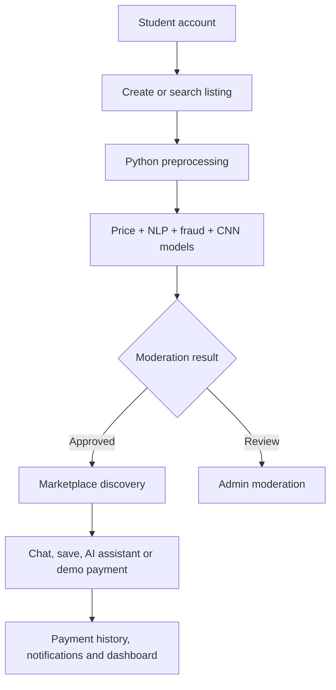

# CampusLoop — AI-Powered Campus Resource Marketplace

A complete Python/Django academic project for students to **buy, sell, rent, borrow and donate** campus resources. It includes authentication, listings, semantic search, personalized recommendations, fair-price prediction, fraud detection, image analysis, an AI chatbot, chat, reviews, notifications, moderation and a visible simulated payment gateway.

See [`FEATURES_PAYMENT_CHATBOT.md`](FEATURES_PAYMENT_CHATBOT.md) for the payment and chatbot workflow, implementation files, and interview explanation.

## Main technology stack

- **Framework:** Django 5 (Python)
- **Database:** SQLite through the Django ORM
- **Machine learning:** scikit-learn
- **CNN:** MobileNetV2 through TensorFlow/Keras
- **Image processing fallback:** Pillow
- **Frontend:** Django templates, HTML, CSS and small browser-side JavaScript

The application logic, database operations and all AI/ML algorithms are written in Python. HTML/CSS/JavaScript are used only because a browser needs them to display and interact with the website.

## AI and ML algorithms

| Feature | Algorithm/model | Python file |
|---|---|---|
| Fair-price prediction | Random Forest Regressor + comparable-listing median | `marketplace/ai/price_prediction.py` |
| Semantic search | TF-IDF vectors + cosine similarity | `marketplace/ai/recommendation.py` |
| Personalized recommendations | Hybrid semantic, freshness, affordability, demand and trust ranking | `marketplace/ai/recommendation.py` |
| Fraud detection | Isolation Forest + explainable business rules | `marketplace/ai/fraud_detection.py` |
| Product image analysis | MobileNetV2 CNN with ImageNet weights | `marketplace/ai/cnn_image.py` |
| Sentiment and text safety | TF-IDF + Logistic Regression + blocked-term rules | `marketplace/ai/nlp.py` |
| Listing draft generation | Template-based NLP generation from structured inputs | `marketplace/ai/nlp.py` |
| Campus AI chatbot | TF-IDF + cosine-similarity retrieval over FAQs and active listings | `marketplace/ai/chatbot.py` |

### Why MobileNetV2?

MobileNetV2 is a lightweight convolutional neural network that uses depthwise separable convolutions. In this project it receives a 224×224 product image, returns the three most likely ImageNet labels and stores an image-quality score with the listing. If TensorFlow is not installed, the project remains usable and performs a local Pillow brightness/contrast quality check.

## Application flow



## Run on Windows

Use **Python 3.11 or 3.12** for the smoothest TensorFlow installation. The base project also works without TensorFlow.

```bat
cd ai_campus_marketplace
py -3.12 -m venv .venv
.venv\Scripts\activate
python -m pip install --upgrade pip
python -m pip install -r requirements.txt
python manage.py migrate
python manage.py seed_demo
python manage.py runserver
```

Open `http://127.0.0.1:8000/` in your browser.

Demo student account:

- Username: `saiteja`
- Password: `Campus@123`

Demo moderator account:

- Username: `admin`
- Password: `Admin@123`

## Enable the MobileNetV2 CNN

The main site works without the large TensorFlow package. To enable the actual CNN:

```bat
python -m pip install -r requirements-cnn.txt
```

The first image analysis may take longer because Keras downloads MobileNetV2 ImageNet weights. After that, uploaded images are classified locally.

## Run automated tests

```bat
python manage.py test
```

The test suite verifies pricing, NLP draft generation, fraud detection, image fallback, semantic discovery, chatbot retrieval, the payment workflow, JSON APIs and saved listings.

## Important demo behavior

- The **Pay / Reserve** button supports UPI, card, wallet and net banking as an academic simulation; it never charges real money.
- The dedicated **Payments** page shows transaction references, methods, status, total paid and total received.
- The **AI Assistant** uses TF-IDF and cosine similarity to answer project questions and retrieve relevant active listings.
- Email verification is represented by a campus-email trust flag; production OTP delivery needs an email/SMS provider.
- The included regression training data is a domain-specific starter dataset. For production, retrain with anonymized completed campus transactions.
- The CNN uses general ImageNet labels. Accuracy can be improved by fine-tuning MobileNetV2 on books, calculators, lab equipment and other campus products.

## Project structure

```text
ai_campus_marketplace/
├── manage.py
├── campus_marketplace/       # Django configuration
├── marketplace/
│   ├── ai/                   # Python AI/ML algorithms
│   ├── management/commands/  # Demo data generator
│   ├── migrations/           # Database schema history
│   ├── static/               # CSS and browser interactions
│   ├── templates/            # Responsive website pages
│   ├── models.py             # Database models
│   ├── forms.py              # Validated forms
│   ├── views.py              # Web pages, workflows and JSON APIs
│   └── tests.py              # Automated tests
├── requirements.txt
└── requirements-cnn.txt
```

## Interview answer

> “I developed the project using Python and Django. I used a Random Forest regression model for price prediction, TF-IDF with cosine similarity for semantic search, recommendations and the retrieval-based AI chatbot, Isolation Forest with explainable rules for fraud detection, Logistic Regression for sentiment analysis, and MobileNetV2 as the CNN for product-image analysis. The project also includes a simulated multi-method payment option with transaction history. SQLite and the Django ORM manage users, listings, messages, payments, reviews and notifications.”

## Demo image sources

Seed data references externally hosted educational/product photographs, including images from [Unsplash](https://unsplash.com/) and a calculator photograph from the [Yamada Denki media article](https://www.yamada-denkiweb.com/media/41982/). Replace them with your own product uploads for a final presentation.
